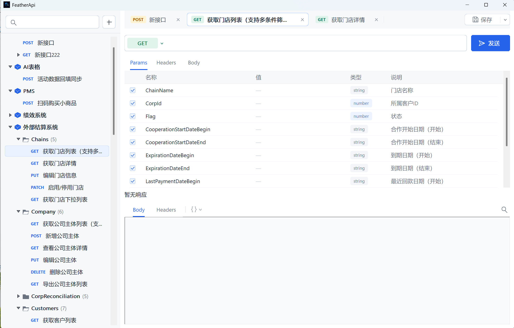

# FeatherApi

**Say goodbye to bloat and debug APIs with the power of a feather.**

[中文](README.zh-CN.md)

FeatherApi is an ultra-lightweight API debugging tool for Windows.



## Why FeatherApi?

- **No bloat**: Built with the native Windows Win32 UI and system networking stack, without Electron or a bundled browser runtime.
- **Fast and portable**: A native single-file application that is convenient to carry on a USB drive, in a developer toolkit, or on a CI workstation.
- **API organization**: Manage folders, subfolders, APIs, request examples, and copy, move, or rename APIs.
- **Complete request editing**: Supports GET, POST, PUT, PATCH, and DELETE, with editable query parameters, headers, JSON, raw, and form requests.
- **Readable responses**: View elapsed time, response headers, and raw or formatted response bodies; hover over the duration to see the status code.
- **JSON tools**: Built-in JSON validation, formatting, and minification, with errors located as precisely as possible by line and column.
- **OpenAPI / Swagger**: Import OpenAPI 3 and Swagger 2 documents to automatically generate folders, request parameters, and JSON examples.
- **Local-first**: API data is stored locally, with no login or cloud account required.

## Lightweight Metrics

| Item | Current status |
| --- | --- |
| Core language | C++17 |
| UI technology | **Native Windows Win32 API + Common Controls** |
| HTTP implementation | Windows WinHTTP |
| Third-party runtime | No Electron / No .NET Runtime required |
| Package size | **v2.0.0: ZIP approximately 527 KiB; EXE approximately 915 KiB** |
| Idle memory usage | **Approximately 18.9 MB** |

FeatherApi stays lightweight by relying only on Windows system components, so no additional dependencies are required.

## Download and Build

### Download a Release

Windows x64 users can download the portable ZIP package from the [latest release](https://github.com/yangka1212/FeatherApi/releases/latest).

### CMake

```powershell
powershell -NoProfile -ExecutionPolicy Bypass -File scripts/build.ps1 -Action Test
```

The script discovers the Visual Studio C++ toolchain and writes artifacts to `build/release`. See the [architecture and development guide](docs/architecture.md) (Chinese) for module boundaries, Debug builds, and packaging.

To test the production EXE against live APIs, exercise core catalog workflows, and capture its actual UI styling on an interactive Windows desktop:

```powershell
powershell -NoProfile -ExecutionPolicy Bypass -File scripts/test-real.ps1
```

See the [real scenario test guide](docs/real-testing.md) (Chinese) for scope, requirements, and how to select your own live API.

## Data Location

The default data file is located at:

```text
%LOCALAPPDATA%\FeatherApi-Win32\data.json
```

## License

FeatherApi is licensed under the [MIT License](LICENSE).

## Code signing policy

Windows code signing is being prepared; existing releases are unsigned.
See the [code signing policy and privacy policy](docs/code-signing.md) for the
planned SignPath Foundation integration, maintainer roles, and signing status.
